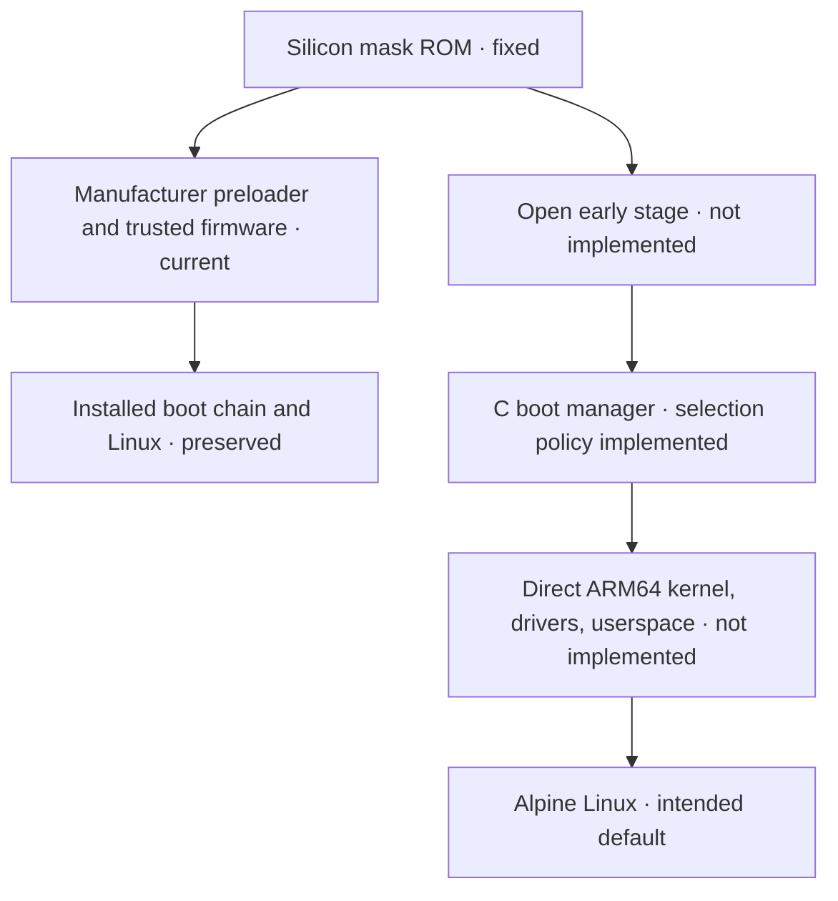
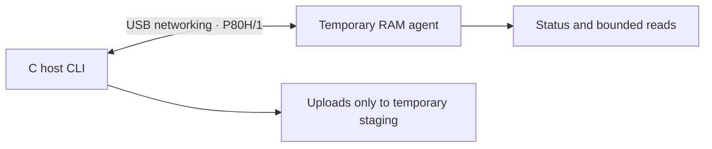

# P80h · Teclast MT8163

Goal: boot Alpine directly from a native C boot manager, with no kexec. The
installed tablet system is preserved. There is no replacement boot firmware or
native Alpine boot yet.

## Boot path

The left side is the tablet today. The right side is the intended open path.
The mask ROM is code fixed in silicon; project work can replace writable stages
that run after it.



## Project connection

The host CLI and tablet agent are C. The agent is uploaded to RAM in the
existing Linux session; it is temporary and does not change a boot partition.
P80H/1 is a versioned binary protocol over USB networking. Downloads are bounded
and checksummed; uploads are restricted to `/tmp/p80h-*` staging paths.



## Bring-up steps

1. **Preserve:** GPT and critical boot copies are verified. A live private eMMC
   read is incomplete and is not a coherent backup or restore proof. No boot
   partition has been changed.
2. **Prove hardware:** bind the mainline drivers below and validate their real
   functions, firmware and power behavior.
3. **Replace writable stages:** implement early memory setup and a recoverable
   loader; prove recovery from RAM before any persistent write.
4. **Boot natively:** connect the C menu to storage, display and input, then hand
   off directly to a mainline ARM64 kernel with its device tree and initramfs.
5. **Default to Alpine:** require repeated cold boots and a recovery route that
   does not depend on the installed boot chain.

## Drivers and device status

`Observed` means identified or bound, not fully working. `Verified` records an
end-to-end check. `Blocked` means no usable open driver/firmware path is proven.

| Area | Mainline driver or block | Status and remaining proof |
|---|---|---|
| CPU/SMP | ARM64 | Observed: four Cortex-A53 cores; stress/topology check remains |
| DRAM | Stock early init | Planned: free MT8163 memory initialization is absent |
| Clocks/pins | `clk-mt8163`, pinctrl | Observed: binds; exact board support and rails need audit |
| eMMC | `mtk-msdc` | Observed: GPT/boot copies verified; live user read incomplete |
| microSD | `mtk-msdc` | Observed: controller binds; card read/write unverified |
| USB gadget | `musb-mtk`, `phy-mt8163` | Verified: P80H/1 link and 4 MiB boot read |
| USB host/OTG | `usb-conn-gpio`, `musb-hdrc` | Observed: binds; keyboard/storage and role return unverified |
| Display | MediaTek DRM, DSI | Observed: framebuffer seen; modes and native handoff unverified |
| Backlight | `pwm-backlight` | Observed: binds; range, sequence and resume unverified |
| Touch | `silead_ts` (GSL1680) | Observed: DT declares device; free firmware and multitouch unknown |
| Buttons | `mt6779-keypad`, `mtk-pmic-keys` | Observed: bind; every key and wake behavior need checks |
| PMIC/power | `mt6397`, `mt6323` | Observed: PMIC/regulators bind; board rails need audit |
| Charger/gauge | `bq2415x`, MT6323 gauge | Observed: chip reports conflict (BQ24156 vs FAN5405 family) |
| CPU frequency | Unverified | Planned: safe OPP and voltage path absent |
| Thermal | `mtk-thermal` | Observed: binds; readings/throttling unverified |
| Wi-Fi | `mt-wifi`, MT8163 CONSYS | Blocked: current stack depends on vendor components |
| Bluetooth | `mtk_btif` | Blocked: BTIF binds; open firmware/stack unproven |
| FM | None verified | Planned: hardware presence unconfirmed |
| GPU | None verified | Blocked: open driver path unproven |
| Video codec | None verified | Planned: blocks and open userspace unknown |
| Audio | `mt8163-afe`, `mt6323-codec` | Observed: bind; playback/capture unverified |
| Cameras | None verified | Planned: sensors not identified independently |
| Accelerometer | `da280` | Observed: DT says `miramems,da280`; orientation/calibration unverified |
| RTC | `mt6397-rtc` | Observed: binds; retention and alarm wake unverified |
| Watchdog | `mtk-wdt` | Observed: one restricted reset returned installed Linux; not independent recovery |
| Suspend | Platform PM | Planned: suspend/resume path incomplete |
| ROM/first stage | No replacement stage | Planned: silicon ROM fixed; open writable payload absent |
| Secure monitor | Existing early stages | Planned: replacement interfaces and recovery not implemented |
| Boot manager | Portable C policy | Implemented: selection/timeout logic; no tablet UI or kernel handoff |
| Alpine | No native install | Planned: direct boot and safe default absent |

## Write gate

Do not write boot or storage partitions until the private backup is complete, an
independent restore route is proven, a RAM-only candidate works, and rollback is
defined. The watchdog return above used the installed boot chain.

## Build

The C host CLI is in [`src/host/`](src/host/); the device link agent is in
[`src/link/`](src/link/). Build entry point:

```console
cc -std=c11 -Wall -Wextra -Werror -pedantic build.c -o build
./build package
```

Authored code is C, at most 100 lines per file. Raw dumps, credentials,
calibration and device-specific data stay in ignored `local/` and never enter
public artifacts.
