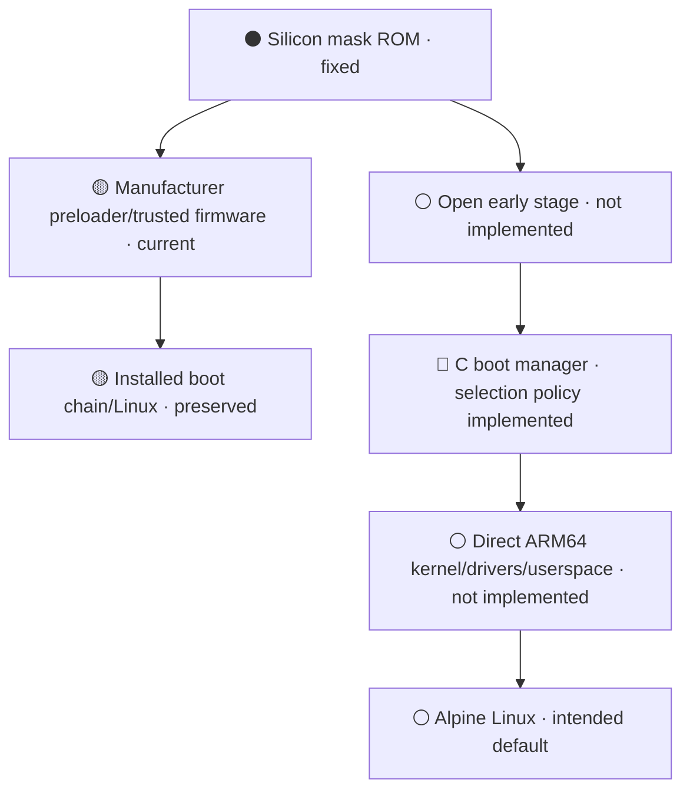
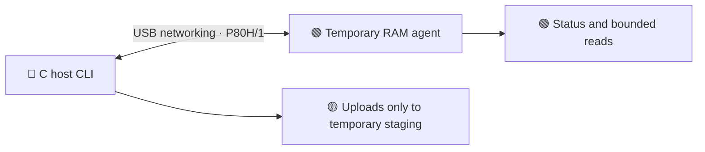

# P80h · Teclast MT8163

Goal: boot Alpine directly through a native C boot manager without kexec; the installed system remains, with no replacement firmware or native Alpine boot yet.

## Boot path

Left: tablet today. Right: intended open path. The mask ROM is fixed in silicon;
project work can replace writable stages that run after it.



## Project connection

The C host CLI uploads a temporary C agent into RAM under the installed Linux.
P80H/1 is a versioned binary protocol over USB networking; downloads are bounded
and checksummed, and uploads only use `/tmp/p80h-*` staging paths.



## Bring-up steps

1. **Preserve:** GPT/critical boot copies are verified. The live private eMMC read
   is incomplete and not a coherent backup or restore proof; no boot was changed.
2. **Prove hardware:** bind the mainline drivers below and validate their real
   functions, firmware and power behavior.
3. **Replace writable stages:** implement early memory setup and a recoverable
   loader; prove recovery from RAM before any persistent write.
4. **Boot natively:** connect the C menu to storage, display and input, then hand
   off directly to a mainline ARM64 kernel with its device tree and initramfs.
5. **Default to Alpine:** require repeated cold boots and a recovery route that
   does not depend on the installed boot chain.

## Drivers and device status

Legend: 🟢 verified · 🔵 implemented · 🟡 observed only · 🔴 blocked · ⚪ planned.

| Area | Mainline driver or block | Status and remaining proof |
|---|---|---|
| CPU/SMP | ARM64 | 🟡 Four Cortex-A53 cores; stress/topology check remains |
| DRAM | Stock early init | ⚪ Free MT8163 memory initialization absent |
| Clocks/pins | `clk-mt8163`, pinctrl | 🟡 Binds; exact board support and rails need audit |
| eMMC | `mtk-msdc` | 🟡 GPT/boot copies verified; live user read incomplete |
| microSD | `mtk-msdc` | 🟡 Controller binds; card read/write unverified |
| USB gadget | `musb-mtk`, `phy-mt8163` | 🟢 P80H/1 link and 4 MiB boot read |
| USB host/OTG | `usb-conn-gpio`, `musb-hdrc` | 🟡 Binds; keyboard/storage and role return unverified |
| Display | MediaTek DRM, DSI | 🟡 Framebuffer seen; modes and native handoff unverified |
| Backlight | `pwm-backlight` | 🟡 Binds; range, sequence and resume unverified |
| Touch | `silead_ts` (GSL1680) | 🟡 DT declares device; free firmware and multitouch unknown |
| Buttons | `mt6779-keypad`, `mtk-pmic-keys` | 🟡 Binds; every key and wake behavior need checks |
| PMIC/power | `mt6397`, `mt6323` | 🟡 PMIC/regulators bind; board rails need audit |
| Charger/gauge | `bq2415x`, MT6323 gauge | 🟡 Chip conflict: BQ24156 vs FAN5405 family |
| CPU frequency | Unverified | ⚪ Safe OPP and voltage path absent |
| Thermal | `mtk-thermal` | 🟡 Binds; readings/throttling unverified |
| Wi-Fi | `mt-wifi`, MT8163 CONSYS | 🔴 Current stack depends on vendor components |
| Bluetooth | `mtk_btif` | 🔴 BTIF binds; open firmware/stack unproven |
| FM | None verified | ⚪ Hardware presence unconfirmed |
| GPU | None verified | 🔴 Open driver path unproven |
| Video codec | None verified | ⚪ Blocks and open userspace unknown |
| Audio | `mt8163-afe`, `mt6323-codec` | 🟡 Binds; playback/capture unverified |
| Cameras | None verified | ⚪ Sensors not identified independently |
| Accelerometer | `da280` | 🟡 DT says `miramems,da280`; orientation/calibration unverified |
| RTC | `mt6397-rtc` | 🟡 Binds; retention and alarm wake unverified |
| Watchdog | `mtk-wdt` | 🟡 One restricted reset returned installed Linux; not recovery proof |
| Suspend | Platform PM | ⚪ Suspend/resume path incomplete |
| ROM/first stage | No replacement stage | ⚪ Silicon ROM fixed; open writable payload absent |
| Secure monitor | Existing early stages | ⚪ Replacement interfaces and recovery absent |
| Boot manager | Portable C policy | 🔵 Selection/timeout logic; no tablet UI or kernel handoff |
| Alpine | No native install | ⚪ Direct boot and safe default absent |

## Write gate

Do not write boot/storage until the private backup and independent restore route
are verified, a RAM-only candidate works, and rollback is defined. The watchdog
return above used the installed boot chain.

## Build

Host CLI: [`src/host/`](src/host/). Device agent: [`src/link/`](src/link/).
Build entry point:

```console
cc -std=c11 -Wall -Wextra -Werror -pedantic build.c -o build && ./build package
```

Authored code is C (100 lines max per file). Raw dumps, credentials, calibration
and device-specific data stay in ignored `local/`, outside public artifacts.
