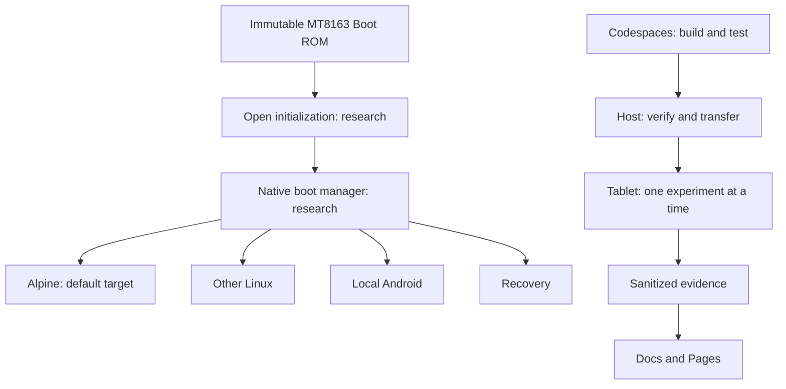

# Architecture

## Boundaries

| Layer | Current implementation | Next evidence |
|---|---|---|
| Silicon ROM | Immutable external dependency | BROM/security survey |
| Early firmware | No replacement yet | DRAM/power specs and RAM test |
| Boot manager | Portable selection policy only | Renderer, storage, native loader |
| Linux | Existing installation is external | Pinned upstream build + board audit |
| Host | New C client for existing daemon | Live transport checks |
| OS | Current installation preserved | Native plain Alpine installation |

No kexec. The menu model is not a bootloader; the SVG is not running firmware.
Settings persistence, image authentication and native handoff need platform work.
No proprietary firmware enters the new repository or public artifacts.

## Host transport

`p80h ping`, `status`, `sh 'COMMAND'`, and `get REMOTE LOCAL` implement the existing
daemon protocol directly in C. `P80H_DAEMON` accepts an IPv4 address and port;
default `172.16.42.1:4444`. This protocol is unencrypted and unauthenticated:
use only the existing isolated USB link or an authenticated local tunnel.

Responses are bounded, commands reject newlines, failed downloads are removed,
and downloads never overwrite an existing destination. Commands return the remote
exit status. There is no new flash or reboot command yet. `sh` still provides the
existing privileged shell capability and must be used deliberately.
